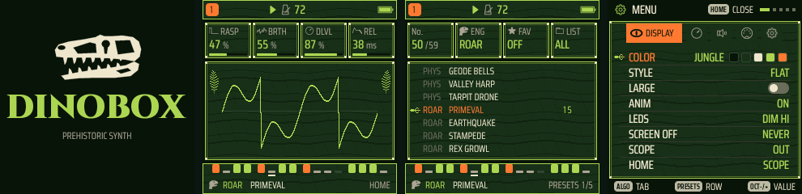

# DINOBOX: FM-1 Prehistoric Synth



**DINOBOX** is epic prehistoric firmware for the **M-VAVE FM-1**: roaring beasts, booming war drums, misty jungle
pads and volcanic rumbles. It is a fork of [GHOULBOX](https://github.com/jasonpersinger/ghoulbox-fm1-dungeon-synth)
2.3.2 by Jason Persinger, itself built on [Felucca](https://github.com/hugelton/Felucca) 1.4.1 by Leo Kuroshita,
Hügelton Instruments. Everything GHOULBOX does (its composer, RING, KEYS, the hall reverb, tape and crush, twelve
voices) works the same; the look, the names and the sounds are new.

**Status: DINOBOX 1.0 has not been tested on a real FM-1 yet.** The host test suite passes, but install it at your
own risk. Holding OCT− while switching on puts the FM-1 into USB rescue mode, from which any firmware (or M-VAVE's
own, `FM-1.fwsc`) can be installed again.

## What's different from GHOULBOX

- **A new interface.** The JUNGLE palette (night green, bone, fern, lava) is a new FM-1's colours, with VOLCANO
  beside it in MENU > DISPLAY > COLOR (GHOULBOX's CRYPT is still there). The windows are rock strata with bone
  knuckles on their corners; the cursor is a three-toed footprint; ferns sway beside HOME's scope; the type is Saira
  Condensed (GHOULBOX: VT323). ROAR's icon is a T. rex head; MENU's DISPLAY tab is a reptile's eye.
- **The boot screen and ABOUT page:** a T. rex skull, the DINOBOX wordmark (Cinzel Black) and "PREHISTORIC SYNTH".
- **ROAR** is GHOULBOX's hurdy-gurdy engine (GURDY), renamed for what it does here: pages DRONE and CALL, its
  controls BRTH (was WHL), RASP (BUZZ) and PULS (COUP, whose CRANK is now TURN). **EPOCH** is GHOULBOX's DREAM: tap
  HOME after KEYS, pick a mood and a key, and it composes a slow piece from your four tracks.
- **45 sounds, renamed and mostly retuned.** GHOULBOX's dungeon sounds became prehistoric ones, in the same slots
  and engines, so projects and user presets saved with GHOULBOX still load.
- **Four new power-on scenes** (MENU > SYSTEM > SCENE): JUNGLE (the default), VOLCANO, STAMPEDE and VALLEY, plus
  BLANK.
- **The TRIBE drum kit** (GHOULBOX's CRYPT kit) and its STOMP pattern.

### The sounds

| Engine | Sounds |
| --- | --- |
| ANALOG | JUNGLE PAD, EPIC STRINGS, CANYON HORN, STOMP BASS |
| VOICE | TRIBE CHANT, EPIC CHOIR, RAPTOR CALL (a hissing screech), REX ROAR (an "oo" opening into a low "ah", with drive) |
| WHEEL | AMBER ORGAN, CANOPY, SWAMP REED, MOSS FLUTE |
| PHYS | LOG MARIMBA, GEODE BELLS, VALLEY HARP, TARPIT DRONE |
| TRIO | PANGAEA PAD, BRONTO HORN (two octaves of low brass), SKY STRINGS, PTERO CRY |
| LOFI | FOSSIL LEAD, DINO CHOIR, BONE WHISTLE |
| PHASE | TITAN BRASS |
| NOISE | VOLCANO (a deep rumble with falling rocks), LAVA CRACKLE |
| ROAR | PRIMEVAL, EARTHQUAKE, STAMPEDE (1/16 thunder), REX GROWL, SWAMP FIDDLE, TRIBE PIPES |
| FM6 | HERO HORNS, FERN PLUCK, COMET CHOIR, DEEP STRINGS, MIST FLUTE, LAVA ORGAN, BRONTO TUBA (F9..F15) |
| SAMPLE | AURORA BOW, REED ORGAN, CAVE FLUTE, RIVER HARP |
| DRUM | TRIBAL KIT, WAR DRUMS |

The FM6 and SAMPLE sounds keep GHOULBOX's patches and recordings under new names; the others are new settings.

## Building

DINOBOX builds exactly as GHOULBOX and Felucca do: see [BUILDING.md](BUILDING.md). On Linux x86-64 (or macOS with
Docker):

```
pip3 install Pillow fonttools
tools/get_toolchain.sh                         # JieLi's toolchain, to ~/.jieli/toolchain
git clone --depth 1 --branch AC79NN_SDK_V1.2.1_2023-12-13 \
    https://gitee.com/Jieli-Tech/fw-AC79_AIoT_SDK.git ~/fw-AC79_AIoT_SDK
FELUCCA_SPARE_MIN=2048 ./build.sh             # -> build/felucca.fwsc (the 2048: see below)
```

`FELUCCA_SPARE_MIN=2048`: GHOULBOX's build refuses an image that leaves under 16 KB of the app slot free (room it keeps
for fixes). DINOBOX's smooth type uses 14 KB of it; its image leaves about 3 KB.

This repository also builds on GitHub: every push to `main` runs `.github/workflows/build-firmware.yml`, which puts
`dinobox.fwsc` and the build's log on the `build-output` branch.

Install `build/felucca.fwsc` with `python3 tools/fm1_install.py build/felucca.fwsc` (needs `pip3 install mido
python-rtmidi`) or with the FM-1 Firmware Hub's installer.

Without the toolchain, `python3 tools/build.py --gen-only && HOST_ONLY=1 tests/run_tests.sh` runs the host tests.

## Changing the sounds

The prehistoric sounds are one table in `tools/ghoulbox_presets.py` (name, the engine's eight EDIT values, the
envelope, mono, the effect sends and a suggested pattern). Edit it, run `python3 tools/ghoulbox_presets.py`, and it
writes them into the engines and the web editor. The scenes are `GB_SCENES` in `firmware/src/engines.c`, the boot
art `tools/gen_ghoulbox_art.py`, the palettes `tools/gen_ui_palettes.py`, the windows and cursor `firmware/src/gfx.c`
(`cv_stone`, `cv_window`, `cv_sword`), the ferns `firmware/src/ui_graph.c` (`torch_draw`) and the T. rex and eye
icons `tools/gen_aa_icons.py` (`OWN`).

## Credits and licence

DINOBOX is free software under the GNU GPL, version 3 only, like GHOULBOX and Felucca: see
[LICENSING.md](LICENSING.md). Its source must stay available to anyone you give the firmware to.

- [GHOULBOX](https://github.com/jasonpersinger/ghoulbox-fm1-dungeon-synth) by Jason Persinger: everything DINOBOX
  is built on. Its README, with the history of all its versions, is in [docs/GHOULBOX-README.md](docs/GHOULBOX-README.md).
  To support its author: [Ko-fi](https://ko-fi.com/ghoulbox).
- [Felucca](https://github.com/hugelton/Felucca) by Leo Kuroshita, Hügelton Instruments.
- Cinzel by The Cinzel Project Authors (SIL OFL 1.1): the wordmark. Saira by The Saira Project Authors (SIL OFL
  1.1): the screen's type.
- The other parts and their licences: [LICENSING.md](LICENSING.md).
