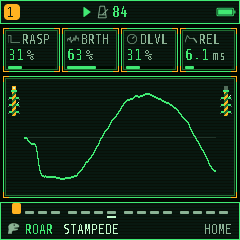
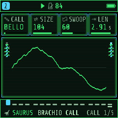
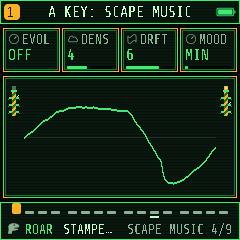

> Integration branch: [Unified SCAPE, SAURUS 2 and dual screens](docs/UNIFIED-SCAPE.md).

# PALEOTONE: FM-1 Prehistoric Synth

> **Early alpha:** experimental firmware. Installation can leave the FM-1 unable to boot and require recovery. Back up projects/settings and retain a known-good firmware before installing. Audio and recording issues remain under investigation.

[Play in your browser](https://fantasmoslam.github.io/Paleotone/webapp/emu/) · **[Install on your FM-1](https://fantasmoslam.github.io/Paleotone/webapp/installer/)** · [Manual](https://fantasmoslam.github.io/Paleotone/manual/)

<p>
  
  
  
  
</p>

**PALEOTONE** (formerly DINOBOX) is epic prehistoric firmware for the **M-VAVE FM-1**: roaring beasts, booming war drums, misty jungle
pads and volcanic rumbles. It is a fork of [GHOULBOX](https://github.com/jasonpersinger/ghoulbox-fm1-dungeon-synth)
2.3.2 by Jason Persinger, itself built on [Felucca](https://github.com/hugelton/Felucca) 1.4.1 by Leo Kuroshita,
Hügelton Instruments. Everything GHOULBOX does (its composer, RING, KEYS, the hall reverb, tape and crush, twelve
voices) works the same; the look, the names and the sounds are new.

**Hardware status:** the owner has tested PALEOTONE on an FM-1, including the lightweight USB second-screen
messages (90 and 91). This does not establish hardware coverage of every feature or development branch.
An earlier experimental screen-companion build required Flipper-assisted recovery; USB rescue alone was
insufficient. Keep a known-good firmware package and recovery instructions before trying experimental firmware.

The [USB second-screen app](https://fantasmoslam.github.io/Paleotone/webapp/screen/) follows the FM-1's controls.
Open it in Chrome or Edge, connect a USB data cable, and allow MIDI/SysEx. This is the graphics companion:
it uses the firmware's C screen renderer and provides Original and Expanded views. This one link covers every
build: the page reads the connected FM-1 and, when the instrument runs a newer companion build, forwards to the
page made for it (`screen-unified/`). It defaults to the working companion source `19727a9`; a firmware and a page
still have to come from matching builds. Opening the webpage does not install firmware. Phone support remains
untested.

The separate [lightweight display](https://fantasmoslam.github.io/Paleotone/webapp/screen-lite/) uses screen-state
messages 90/91 and is not a replacement for the graphics companion.

## What's different from GHOULBOX

- **A 1993 park-operations terminal.** The TERMINAL palette (phosphor green on black, amber for what needs
  attention) is a new FM-1's colours; JUNGLE and VOLCANO are beside it in MENU > DISPLAY > COLOR (GHOULBOX's CRYPT
  too). The windows are green-screen glass with faint scanlines and amber corner brackets; the cursor is a prompt;
  electric fence posts with blinking warning lamps stand beside HOME's scope; the type is Share Tech Mono drawn as
  pixels (GHOULBOX: VT323). ROAR's icon is a T. rex head; MENU's DISPLAY tab is a reptile's eye.
- **The boot screen and ABOUT page:** a Dilophosaurus skull, the PALEOTONE title in big terminal pixels and "PREHISTORIC
  SYNTH".
- **ROAR** is GHOULBOX's hurdy-gurdy engine (GURDY), renamed for what it does here: pages DRONE and CALL, its
  controls BRTH (was WHL), RASP (BUZZ) and PULS (COUP, whose CRANK is now TURN). **SCAPE MUSIC** coordinates four unequal musical loops with one chord progression and a shared breathing arc.
  SCAPE has one performance workspace: SELECT changes its control bank, the four knobs edit the visible controls, and HOME exits. The track overview stays visible while editing music, mix, habitat or scene actions.
  See [SCAPE controls](docs/UNIFIED-SCAPE.md) and the [listening guide](https://fantasmoslam.github.io/Paleotone/webapp/scape-preview/scape-guide/).
- **121 sounds of its own, nothing inherited.** Every sound in PRESETS is PALEOTONE's: GHOULBOX's slots hold new
  prehistoric settings (projects and user presets saved with GHOULBOX still load, in the same engines), 64 more join
  them (SAURUS's 22 among them), and Felucca's stock sounds are hidden (a project that uses one still plays it).
- **Its own sample material, synthesized**: a night jungle, a tropical storm, a lithophone and the ENCOUNTER kit
  (footfalls near and far, a mud stomp, a claw tap, a branch snap, a falling tree, a splash, a rock fall, leaves,
  bone clacks, a ground ripple, thunder, a huff), in the place of GHOULBOX's four recordings, 12 KB smaller.
- **New FM6 patches F9..F15** and **the TRIBE drum kit**: BOOM, SKIN, CLAP, SEEDS, RATTL, LOG, BONE and ROCK.
- **Four new power-on scenes** (MENU > SYSTEM > SCENE): JUNGLE (the default), VOLCANO, STAMPEDE and VALLEY, plus
  BLANK.

### SAURUS, the creature voice

An engine of its own (engine 15): one note is one call, with up to three layered throats. Four throat sets are shared across tracks. Controls:

| Control | What it does |
| --- | --- |
| CALL | The call's shape over its length: HOLD (a drone), BELLOW, ROAR, BARK, HOOT, TRILL, CHIRP, MOAN, HISS, SNORT, SHRIEK, HONK, BOOM, RATTLE |
| SIZE | The animal: small (high throat) to sauropod (formants two octaves down) |
| SWOOP | How far the call's pitch moves (up to two octaves) |
| LEN | How long the call takes (1 ms to 10 s); the ADSR still shapes and ends the note |
| GROWL | Roughness: a subharmonic, jitter, wider throat bands and drive |
| BRTH | Breath noise in the voice |
| MOUTH | Closed "oo" to open "ah"; the call opens and closes it |
| WILD | Each note's own variation: length, pitch, roughness |

20 creatures: BRACHIO CALL, TYRANT ROAR, RAPTOR BARK, RAPTOR CHAT, CREST HOOT, PTERO SHRIEK, HERD MOAN, FRILL HISS,
SAURO SNORT, DEEP RUMBLE, TITAN APE, NEST CHIRPS, SWAMP CROAK, MONSTER ROAR, DISTANT HERD, LOW GROWL, BABY REX, SEA
MONSTER, HADRO HORN, COMPY PACK. All synthesised.

### The sounds

| Engine | Sounds |
| --- | --- |
| ANALOG | JUNGLE PAD, EPIC STRINGS, CANYON HORN, STOMP BASS, AMBER LEAD, SWAMP BASS, FERN SWELL, STAR SKY, ICE AGE PAD |
| VOICE | TRIBE CHANT, EPIC CHOIR, RAPTOR CALL, REX ROAR, DEEP CHANT, SPIRIT VOX, SHAMAN, NIGHT WAIL |
| WHEEL | AMBER ORGAN, CANOPY, SWAMP REED, MOSS FLUTE, TEMPLE ORGAN, BONE KEYS, LAGOON |
| PHYS | LOG MARIMBA, GEODE BELLS, VALLEY HARP, TARPIT DRONE, HIDE DRUM, WATER DROPS, BOWED BONE, SITAR VINE, TUSK TINES |
| TRIO | PANGAEA PAD, BRONTO HORN, SKY STRINGS, PTERO CRY, LAVA BRASS, SPORE CLOUD, PRIMAL STAB, AURORA PAD |
| LOFI | FOSSIL LEAD, DINO CHOIR, BONE WHISTLE, PIXEL RAPTOR, EGG ARP, CAVE ECHO |
| PHASE | TITAN BRASS, ICE CRYSTAL, RESIN PAD, DEEP PULSE |
| NOISE | VOLCANO, LAVA CRACKLE, MONSOON, GEYSER, SWARM, WIND RIDGE |
| ROAR | PRIMEVAL, EARTHQUAKE, STAMPEDE, REX GROWL, SWAMP FIDDLE, TRIBE PIPES, WAR CHANT, TUNDRA, WAR PARADE, JUNGLE CAMP, RITUAL FIRE, TITAN MARCH, HEARTBEAT, HERD RUN, TRIBAL WAR, TALK DRUMS, ODD RITUAL, FIVE MOONS, SPIRAL, CHAOS DRUMS |
| FM6 | TAR PIT BASS, SLIT DRUM, MAMMOTH, GLACIER PAD, METEOR, CICADA BUZZ, AMBER BELLS (patches F9..F15), TAR GROWL, MAMMOTH CALL, GLACIER WIDE |
| SAMPLE | JUNGLE NIGHT, ENCOUNTER (the kit, one sound per key from F3), LITHOPHONE, TROPIC STORM |
| GRAIN | NIGHT SWARM, STONE MIST, STORM CLOUD, AMBER DUST (grains of the jungle, the stones and the storm) |
| DRUM | TRIBAL KIT, WAR DRUMS, BONE RATTLE, RITUAL |
| SAURUS | the 20 creatures above |

The sample material is made by `tools/gen_dino_samples.py` (no recordings), the FM6 patches are in
`tools/gen_fm6_patches.py`, the TRIBE kit in `firmware/src/drum_voice.c`.

## Building

PALEOTONE builds exactly as GHOULBOX and Felucca do: see [BUILDING.md](BUILDING.md). On Linux x86-64 (or macOS with
Docker):

```
pip3 install Pillow fonttools
tools/get_toolchain.sh                         # JieLi's toolchain, to ~/.jieli/toolchain
git clone --depth 1 --branch AC79NN_SDK_V1.2.1_2023-12-13 \
    https://gitee.com/Jieli-Tech/fw-AC79_AIoT_SDK.git ~/fw-AC79_AIoT_SDK
./build.sh                                     # -> build/felucca.fwsc, the package to install
```

This repository also builds on GitHub: every push to `main` runs `.github/workflows/build-firmware.yml`, which puts
`paleotone.fwsc` and the build's log on the `build-output` branch.

Install `build/felucca.fwsc` with `python3 tools/fm1_install.py build/felucca.fwsc` (needs `pip3 install mido
python-rtmidi`) or with the FM-1 Firmware Hub's installer.

Without the toolchain, `python3 tools/build.py --gen-only && HOST_ONLY=1 tests/run_tests.sh` runs the host tests.

## Changing the sounds

The prehistoric sounds are one table in `tools/ghoulbox_presets.py` (name, the engine's eight EDIT values, the
envelope, mono, the effect sends and a suggested pattern). Edit it, run `python3 tools/ghoulbox_presets.py`, and it
writes them into the engines and the web editor. The scenes are `GB_SCENES` in `firmware/src/engines.c`, the boot
art `tools/gen_ghoulbox_art.py`, the palettes `tools/gen_ui_palettes.py`, the windows and cursor `firmware/src/gfx.c`
(`cv_stone`, `cv_window`, `cv_sword`), the fence posts `firmware/src/ui_graph.c` (`torch_draw`) and the T. rex and eye
icons `tools/gen_aa_icons.py` (`OWN`).

## Credits and licence

PALEOTONE is free software under the GNU GPL, version 3 only, like GHOULBOX and Felucca: see
[LICENSING.md](LICENSING.md). Its source must stay available to anyone you give the firmware to.

- [GHOULBOX](https://github.com/jasonpersinger/ghoulbox-fm1-dungeon-synth) by Jason Persinger: everything PALEOTONE
  is built on. Its README, with the history of all its versions, is in [docs/GHOULBOX-README.md](docs/GHOULBOX-README.md).
  To support its author: [Ko-fi](https://ko-fi.com/ghoulbox).
- [Felucca](https://github.com/hugelton/Felucca) by Leo Kuroshita, Hügelton Instruments.
- Share Tech Mono by Carrois Type Design (SIL OFL 1.1): the screen's type and title.
- The other parts and their licences: [LICENSING.md](LICENSING.md).
