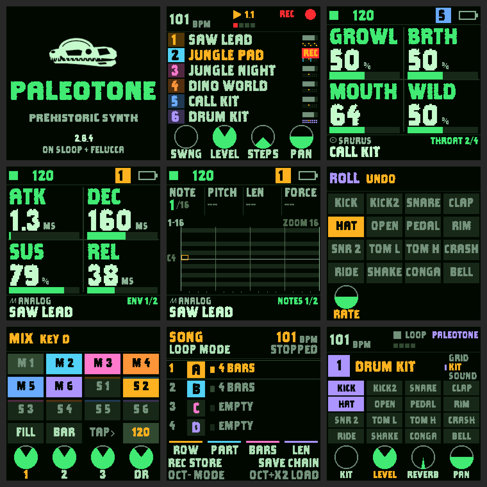
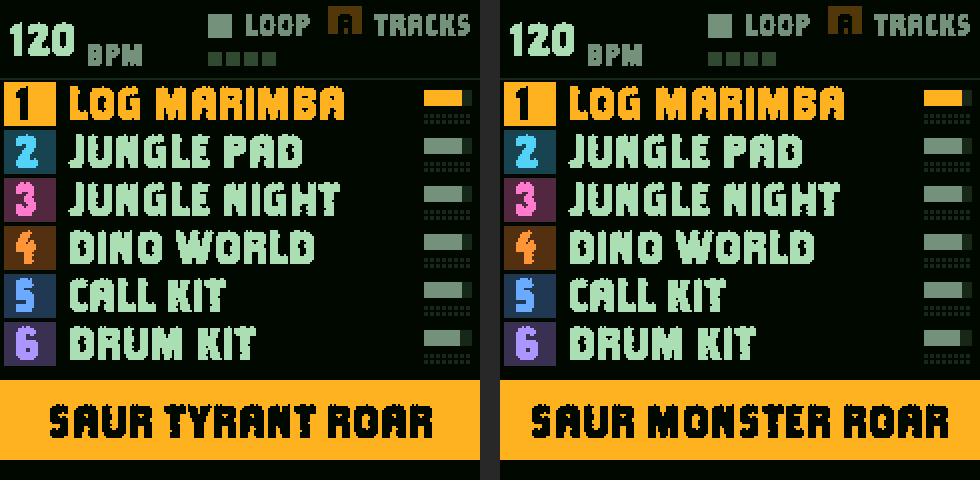

<p align="center"><br>
</p>

<p align="center"><b>PALEOTONE: prehistoric synth firmware for the M-VAVE FM-1.</b><br>
Six tracks, SAURUS creature calls, ROAR drones and war drums, on a groovebox you play live.</p>

<p align="center">
<a href="https://fantasmoslam.github.io/Paleotone/webapp/emu/"><b>Play it in your browser</b></a> ·
<a href="https://fantasmoslam.github.io/Paleotone/webapp/installer/"><b>Install on your FM-1</b></a> ·
<a href="https://fantasmoslam.github.io/Paleotone/webapp/editor/">Editor</a> ·
<a href="web/site/art/demo-song.mp3">Hear the demo song</a> ·
<a href="BUILDING.md">Building</a> ·
<a href="../../issues">Report a bug</a>
</p>

> **Early alpha:** experimental firmware. An install can leave the FM-1 unable to start and in need of recovery.
> Back up your projects with the editor, keep a known-good firmware package, and read the recovery notes on the
> install page before installing.

<p align="center"></p>

## What it is

PALEOTONE is the prehistoric sound of the earlier PALEOTONE (its presets, samples, SAURUS and ROAR engines, drum kits
and effects) on **RAPTOR's base**: SLOOP 2.8.4 by isod89, the live groovebox firmware built on Felucca. The look is a
1993 park-operations terminal: phosphor green on black, amber for what needs attention, and one typeface, Clayborn,
drawn large on every screen.

| | |
|---|---|
| **Six tracks** | three synths, SFX (the prehistoric world's sounds), CALLS (SAURUS) and drums, each with its own colour |
| **SAURUS** | the creature voice: one note is one call (CALL, SIZE, SWOOP, LEN, GROWL, BRTH, MOUTH, WILD); twenty creatures, and CALL KIT with every one of them on the keys |
| **ROAR** | drones, war drums and rituals, with its RING page back (EDIT > RING, on or off) |
| **PRESETS by kind** | 200+ sounds in ten kinds: BASS, KEYS, ORGN, PAD, LEAD, PLCK, DRUM, FX, and SAUR and ROAR for the creatures and the drones. Turning PRESETS names the sound and its kind at the top of the screen and in a big bar over the knobs (SAUR TYRANT ROAR) |
| **Big text** | Clayborn everywhere, values large on every value page, messages as big as they fit |
| **Demo song** | VALLEY OF GIANTS on all six tracks: the first power-on plays it, TOOLS > DEMO brings it back |
| **Everything SLOOP does** | the sequencer, song mode, punch-in effects, the piano roll, parameter locks, the editor |

<p align="center"></p>

## Play it in your browser

**[fantasmoslam.github.io/Paleotone/webapp/emu](https://fantasmoslam.github.io/Paleotone/webapp/emu/)** runs the
firmware's own sound, sequencer and screens in the page (WebAssembly; `web/emu/paleo_web.c`). Play with the mouse or
the computer keys printed on the panel, or with a MIDI keyboard. Nothing is installed, and projects are not kept in
the browser.

## Install

1. Back up the FM-1's projects with the [editor](https://fantasmoslam.github.io/Paleotone/webapp/editor/).
2. Open the **[installer](https://fantasmoslam.github.io/Paleotone/webapp/installer/)** in Chrome or Edge, connect
   the FM-1 straight to the computer with a USB data cable, close other MIDI apps, and press **Install**.

The command line does the same: `python3 tools/fm1_install.py paleotone-fm1.fwsc --yes` (needs
`pip3 install mido python-rtmidi`). Every push to `main` builds the package in GitHub Actions
(`.github/workflows/paleotone-fm1.yml`) and puts it, with the build and test logs, on the
[`paleotone-fm1-output`](../../tree/paleotone-fm1-output) branch.

If an install fails and the FM-1 no longer starts: hold OCT− alone while switching on for USB rescue; if that does
not help, recovery needs a Transporter ([FM-1-transporter](https://github.com/kurogedelic/FM-1-transporter)).
M-VAVE's own updater, M-UPGRADE, takes the FM-1 back to the official firmware.

## Building

See [BUILDING.md](BUILDING.md): JieLi's toolchain and the AC79 SDK, then `./build.sh` makes `build/felucca.fwsc`.
Without them, the host tests and the browser version still build:

```
python3 -c 'import sys; sys.path.insert(0, "tools"); import build; build.generate()'   # build/gen
sh tests/run_tests.sh                       # the host tests (after one ./build.sh)
sh web/emu/build.sh                         # build/emu: PALEOTONE in the browser (clang, lld, wasi-libc)
node web/emu/emu_test.mjs build/emu/paleotone.wasm
```

The website (`.github/workflows/paleotone-site.yml`, `web/make_paleotone_site.py`) is published on GitHub Pages after
every green FM-1 build of `main`: the browser version, the installer (`web/paleotone_install.html`), the editor and
the art in `web/site/art`.

This tree is also RAPTOR, the same groovebox on the M-VAVE SMK-37 (`./build.sh --board smk37`; see
[SLOOP-PRO.md](SLOOP-PRO.md)). The earlier PALEOTONE, built on GHOULBOX, is in this repository's history.

## Credits and licence

PALEOTONE is free software under the GNU GPL, version 3 only: see [LICENSING.md](LICENSING.md) and
[CREDITS.md](CREDITS.md). Its source must stay available to anyone you give the firmware to.

- **SLOOP** by isod89 and contributors ([README-SLOOP.md](README-SLOOP.md)), and the SMK-37 port by M. Geisler
  ([@genkigenki](https://github.com/genkigenki)).
- **Felucca** by Leo Kuroshita ([@kurogedelic](https://github.com/kurogedelic)), Hügelton Instruments.
- **GHOULBOX** by Jason Persinger, where PALEOTONE's sound began.
- **Clayborn** by Frank Baranowski (SIL OFL 1.1): the screen's typeface.
- The browser version follows charlesvestal's [X0X](https://github.com/charlesvestal/fm1-x0x) browser build.

M-VAVE and FM-1 are trademarks of their respective owners; PALEOTONE is not affiliated with them.
