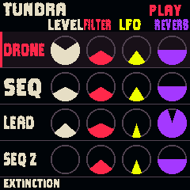

# Physical detent counting and literal UI steps

Dylan reported that all detented controls either skipped ahead or took several clicks to move one item. The physical decoder still used the old short-pause, multiple-rest-state learner. It could learn halfway through a click after roughly 44 ms and either count that state as another detent or stop recognizing completed clicks. Its persistent direction guess also lost an immediate fast reversal.

The corrected encoder-only block is adapted from Paleotone main 6f027f0f34101fa70a1b74a045745ba1a81eb773, firmware/hal/fm1_input.h (the Felucca full-detent correction described there). An FM-1 click is counted as one full quadrature cycle returning to one resting state. A stationary park of about one second can recover from booting off the detent. Only the current partial click supplies direction for a missing sampled phase; ambiguous opposite-state samples do not invent movement from a preceding click. Key debounce, matrix cadence and LED scanning are unchanged.

Velocity acceleration is removed from the application, including its state, helper and simulator bypass. A decoded click advances one item or one parameter step at any speed. Coalesced input preserves the same number of steps, including through zero. The analog volume path is unchanged.

## Reproduction and checks

New physical-input tests exercise all seven encoders and all four starting phases: slow and fast turns, mid-click pauses, immediate reversals, missing sampled phases, bounce, partial reversals and off-detent boot recovery. Before correction, five slow clicks counted zero and five clicks with halfway pauses counted nine. After correction, these tests pass for every encoder/phase. Fundamentally ambiguous two-state samples are explicitly tested to generate no invented direction.

The UI scenario verifies a 100-click sweep, one-click reverse corrections, exact movement through zero and one-item voice/preset selection. Font-render tests also pass. Native image is 544,364 / 581,564 bytes; RAM 95,596 / 98,304; pool 334,472 / 344,064. Dylan subsequently reports “Works much much better”; this is the accepted physical knob response.

## Home readability

Home track names use the largest supported cut that fits their 56 px text area: 32 px for short names, or a tall 24 px condensed cut. No track name falls back below 24 px; the font test checks every name. Full names, 36 px gauges, the approved colors and the single NightClaw typeface family remain. The extra cut is tested with every printable glyph and canvas clipping.

All 39 control scenarios pass with these changes. The eleven-cut font renderer comparison and Home-name width checks pass.

## Installation

Source f9b11d6 installed successfully (installer exit 0). NightClaw reconnected and answered its status handshake with RAPTOR NIGHT playing at 130 BPM. Package SHA-256: 641cd0a0784ca05baf0b17c6878b479c7a30fcd82f1510a99ffae805f37337ed. Dylan has accepted the corrected physical knob feel. Direct readability feedback across all pages remains open.

Full CI run [43139217653](https://github.com/fantasmoslam/Paleotone/actions/runs/43139217653) passed. Published output commit 1086a04d6dbda6ca95f6b8cc07ec67a75ca310f2 identifies this source as successful; its checksum matches the installed package above.
