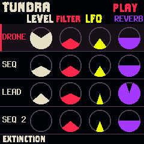
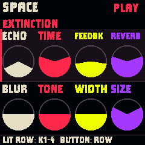
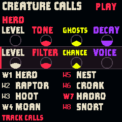
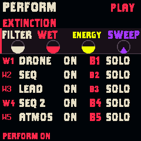

# NightClaw approved palette

Dylan approved the saturated preview: bone white, crimson, sulfur yellow and electric violet on near-black. The earlier dusty Bone and Copper proposal is superseded.

| Role | Color | RGB source |
|---|---|---|
| Background | Near-black | #050508 |
| Selected row | Dark charcoal | #1B1218 |
| Text / first column | Bone | #E6DCC2 |
| Selection / second column | Crimson | #FF284E |
| Third column | Sulfur | #EAFF00 |
| Fourth column | Electric violet | #A63AFF |
| Empty indicator rims | Dark stone | #534556 |

The columns retain the same colors across every control page. Layer, pattern and effect tokens use the same colors and matching dark tints. The monochrome jungle title, typography, control geometry, accepted encoder response and audio are unchanged.

Native and host builds pass. Home and Space screenshots match the approved preview exactly. Native image is 543,948 / 581,564 bytes; RAM remains 95,644 / 98,304 and pool 334,472 / 344,064.

Source 35c98f8 is installed after explicit user authorization to proceed despite unsaved edits. The installer completed with exit 0; NightClaw reconnected and answered its status handshake with RAPTOR NIGHT playing at 130 BPM, F# Phrygian. The earlier automatic approval block is resolved.

Installed package SHA-256: 7f00468862be85c5a3af0f19b9c26ddd842486417cda5fe55a9df98558b94320.

## Home gauge correction

Home now uses 36 px diameter gauges instead of 24 px. The four track rows remain visible; full track names occupy a left column, with muted status below the name. Gauges have 49 px column spacing and sit within their 46 px rows. The approved colors and encoder response are retained. Setup, Space and Lead captures are pixel-for-pixel identical to the prior approved-palette build. The native build and focused knob scenario pass; image 544,188 / 581,564 bytes, RAM/pool unchanged. Source 2f059a8 installed successfully (installer exit 0). After USB settled, NightClaw answered its status handshake with RAPTOR NIGHT playing at 130 BPM.
