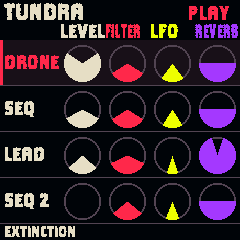
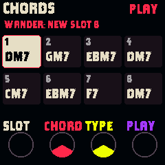
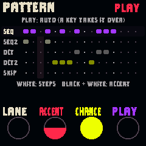
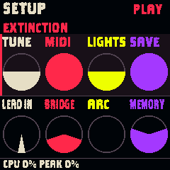
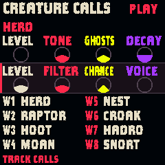
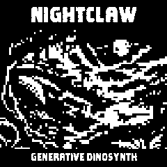

# NightClaw typeface correction

The firmware now generates one NightClaw UI family from its licensed Clayborn source. Every role, including XS, S, B, M, L and C, uses that family. No original bitmap typeface or original-font fallback is emitted. Three unavailable punctuation marks are drawn as simple symbols rather than substituted from another font.

Home track names use 20 px text in a 60 px side column. Its four gauge columns retain 36 px diameter indicators and the approved palette. The narrow 20 px cut keeps long column labels large instead of falling back to the old face. Muted status uses the same family.

Edit has a large Chords header, larger chord cards and 20 px control labels. Slot numbers, held-slot text and save/status messages use the same family. Pattern and the effects grid also use it, as do startup, update and diagnostic messages through the shared font roles. No original-font role remains in the generated font set.

## Validation

All 39 control scenarios pass with the new family, including the 91-knob audit. Every printable glyph in all ten cuts passes the packed-versus-alpha pixel comparison at the canvas edges. Width assertions keep Home names in the tall cut and its headers within their columns. The effects-grid fit check measures the actual narrow face now drawn there. Edit and Pattern scenarios were rerun after the final message-header adjustment.

Native image: 540,844 / 581,564 bytes. RAM: 95,644 / 98,304. Pool: 334,472 / 344,064. Font bitmap data: 24,694 bytes. Audio, instrument recipes, saved state format and encoder response are unchanged. Full CI is separate from these local results.

Actual simulator captures:

The candidate is built and prepared for installation.
