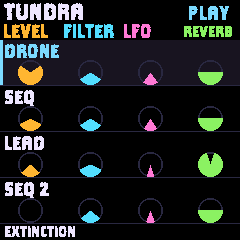
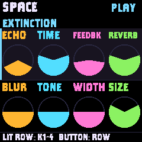
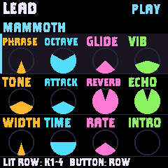
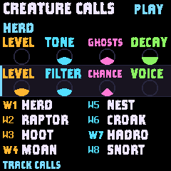
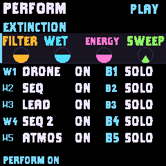

# NightClaw screen visibility

This records the first visibility pass. The [complete typeface correction](NIGHTCLAW-TYPEFACE.md) supersedes its mixed font set and Home label sizing.

Reference: Paleotone main 6f027f0f34101fa70a1b74a045745ba1a81eb773, especially tools/gen_font.py, firmware/src/gfx.c and firmware/src/ui_studio.c. The useful patterns are condensed 16/20/24 px type, choosing the largest size that fits, compact one-bit glyphs, and using the available area for clear indicator shapes.

NightClaw retains its four-column controls and colored filled indicators. Home uses four 46 px rows under a 40 px header; the current scene name remains visible in the footer. Other ordinary control pages distribute their available height across their actual two, three or four rows, instead of reserving four rows and leaving empty space. Two-row pages use 52 px diameter indicators, three-row pages 36 px, with compact indicators on four-row and special pages. Creature and Performance key maps keep their reserved regions.

Condensed type from the same licensed Clayborn source supplies 16/20/24 px cuts. Titles and labels take the largest permitted size that fits; smaller bold fallbacks preserve complete labels. Labels use capitals. There are no simulated knob bodies, numeric parameter readouts or added animations. The accepted physical encoder response is unchanged.

Binary font bitmaps use one bit per pixel, adapted from Paleotone. Antialiased font sets retain their four-bit path. Each generated packed glyph is checked against its original pixels. The host font test compares every printable character in all nine default fonts against an equivalent four-bit rendering, including canvas edges and clipping. Original Terminus advances and glyph pixels remain unchanged. Font licenses and source notices remain with the assets.

The original RGB565 strip renderer and audio memory allocation are retained. Screens redraw when their existing state signature changes; this work adds no steady animation. Device readability and UI load while turning controls need physical feedback after installation.

## Validation

Native image: 543,932 / 581,564 bytes (37,632 bytes free), compared with 581,516 bytes before this pass. RAM remains 95,644 / 98,304 and the pool remains 334,472 / 344,064. All 39 control scenarios, the new per-glyph packed/alpha renderer comparison, and package/updater/installer checks pass locally. Default font bitmap data is 26,902 bytes for nine cuts, compared with 74,948 bytes for the former six cuts. Full CI is separate and pending.

Actual 240 x 240 simulator captures:

## Installation

Source 0cb944a installed successfully. The device reconnected as NightClaw, answered the screen-reader handshake and resumed HIGH FRONTIER at 116 BPM. Installed package SHA-256: ba68402ec886919313ab19c9e03fc5d03c89f82defa035775d05b73d6ca54a46. Physical readability and UI response while turning controls await user feedback.
