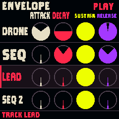

# NightClaw quick start

The static jungle title screen stays visible for at least three seconds at startup.

## Choose a scene and play

Turn PRESETS. RAPTOR NIGHT is the signature reference; BONE RIDER is the next scene. Also try DUST TRAIL, RED MESA, FOSSIL PASS, HIGH FRONTIER and NIGHT RIDER. The new western scenes leave automatic Lead melody off so you can play over the drums.

Outside Calls or Performance mode, the white keys play Lead in the scene's scale. To hear the familiar RAPTOR NIGHT combination, select Lead on Home and turn ALGORITHM to Theremin.

## Edit a track

Press HOME until the track table appears. Turn SELECT to choose Drone, Sequence, Lead, Sequence 2, Atmosphere, Skin or Calls. The view follows the selected row.

| Right encoder | Job on the selected row |
|---|---|
| 1 | Level |
| 2 | Filter / tone |
| 3 | LFO; Ghosts for Skin; Chance for automatic Calls |
| 4 | Reverb send |

Turn ALGORITHM to change the selected melodic instrument, Atmosphere character, Skin beat or Calls creature. Instrument and beat choices are independent.

The final four instruments on every melodic track are **Cello, Cello Low, Sub Pad and Fat Pad**. Lead is useful for playing cellos; Drone provides sustained low pads. Drone's new cello voices use a lower register and its bass pads a still deeper one. The Lead and sequence octave controls retain their usual behavior.

Skin offers GALOP, TRES, WAR, RAIN, QUAKE, WAR2, TALK, SEVEN, PENTA, SPIRAL, CHAOS, TRAIL, OUTRIDER and HUNT. Ghosts adds optional accents; zero retains the main beat.

## Shape the envelope

On Home select a track, then tap SAVE for Envelope. SELECT chooses the row; K1–K4 edit **Attack, Decay, Sustain, Release**. Four rows are visible at once; the table scrolls to Calls and Atmosphere. ALGORITHM changes that row’s instrument. SAVE again opens its sound page.

Attack is the rise to full level; Decay falls toward Sustain, the held level; Release fades after note-off. These controls shape native and imported instruments. Untouched stages inherit the instrument’s envelope. Turn a stage below zero to restore its inherited setting. Manual stages survive changing instruments and save with each scene using GLO.

Sequences retain their separate note lengths and tone decay. Atmosphere uses Play/rest as its gate; creature calls retain their timed gates. Skin retains percussion Decay on its drum page rather than a held-note ADSR. Sampled and modeled instruments keep their natural duration and timbre decay: Sustain cannot extend a finite recording.

## Trigger creatures

On Home select Calls, or tap SAVE twice while Calls is selected to reach its sound page. The first eight white keys, left to right, trigger **Herd, Raptor, Hoot, Moan, Nest, Croak, Hadro and Snort**.

- First black key: toggle Manual / Auto.
- Second black key: stop the current call.
- Calls Level zero or auxiliary mute silences calls.

Manual mode is the boot default and works with the music stopped or held. Select Lead again to return the keyboard to instrument playing. Auto is a temporary performance choice rather than a saved preset setting.

## Save, reset and check CPU

| GLO action | Result |
|---|---|
| Brief tap from Home | Open Setup |
| Hold about half a second, then release | Save edits |
| Hold about 1.5 seconds until RESET | Restore the current scene's factory settings |

The physical SAVE button opens sound pages; it is not the save-edits shortcut. Save before switching off or updating firmware. After saving, Setup's Save status reads Saved.

Setup shows CPU average/peak and a **!** count if audio dropouts occurred. The screen-reader diagnostic also identifies two-core operation. The tested HIGH FRONTIER live-Lead performance now plays cleanly at about 65% average and 91% peak; other combinations can differ.

PLAY rests/resumes the music. A short REC tap toggles Hold. SEL enters Performance; a page button returns to ordinary editing. Instrument choices, beat and mix edits save with each scene.

## Knob response

Each physical detent is one selection or one parameter step, regardless of turn speed. There is no velocity acceleration, centre catch or three-click dead zone. Reversing direction works immediately. The main volume pot retains its existing analog response.
